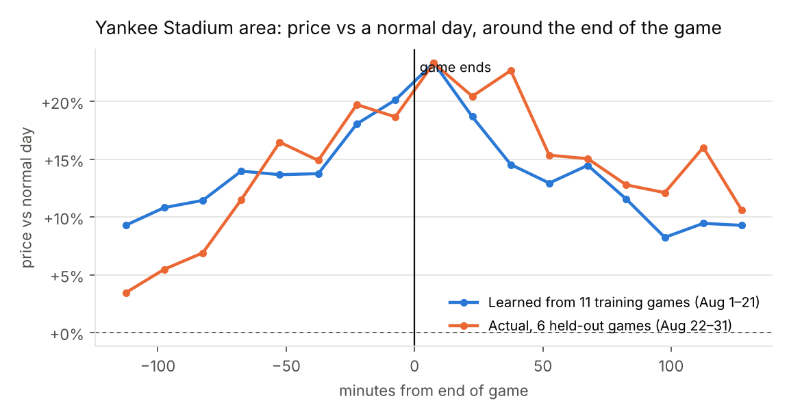
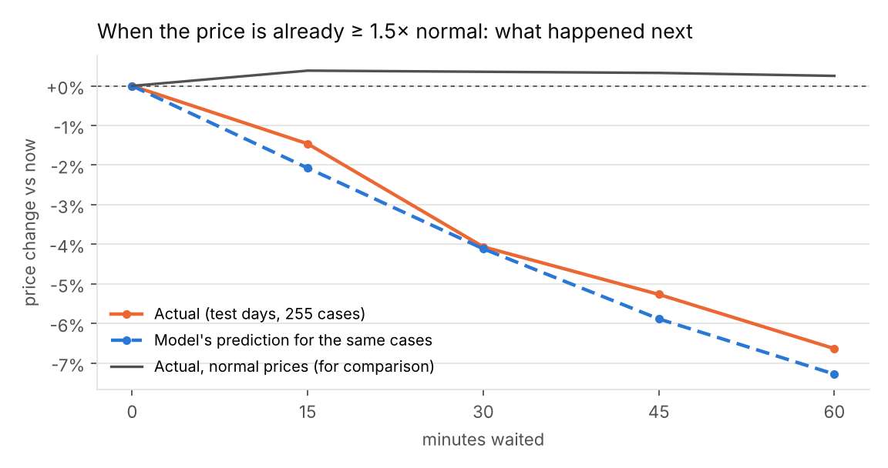

# Case studies — where the data shows a clear, repeatable pattern

Generated by `python -m ml.case_studies` on 2026-10-10 from real NYC TLC trip data (Aug 2024). Fitted on training days/games, checked on held-out ones.

## 1. Event exit — Yankee Stadium (real MLB games, Aug 2024)

Price index in the stadium's own taxi zone by minutes from the end of the game, vs the
same zone at the same clock time on non-game days. The **model** is the average curve of the training games;
it is tested on games it never saw.

- Training games: 11; held-out games: 6 (all Yankee Stadium; Citi Field had no home games in the test days).
- Learned pattern: prices peak **+23%** at 0–15 min after the end, then ease (bin means: -30: +18%, -15: +20%, +0: +23%, +15: +19%, +30: +15%, +45: +13%, +60: +14%, +75: +12%, +90: +8%).
- Held-out games, 0–45 min after the end: actual **+22%** vs learned +19%.
- Prediction error on held-out games (all bins): learned curve **5.6%** vs "no event effect" 14.5% → the learned curve is better.
- Caveat: one venue, a handful of held-out games, baseball crowds in New York. Not measured in Malaysia.

## 2. Surge fall-back — prices already far above normal (test days Aug 26–31)

Level = current price ÷ expected price for the trip (from half of the trips); the outcome is measured on
the other half, so noise cannot fake a fall-back. Model = the served with_level model.

| Price now | Cases | Actual change at +30 / +60 min | Model predicted | Actual chance of ≥10% drop by +30 | Model said |
|---|---|---|---|---|---|
| normal (< 1.2×) | 69,211 | +0.4% / +0.3% | +0.5% / +0.5% | 11% | 11% |
| 1.2–1.5× | 8,163 | -0.2% / -0.5% | -0.1% / -0.4% | 16% | 16% |
| ≥ 1.5× | 255 | -4.1% / -6.6% | -4.1% / -7.3% | 33% | 31% |
| ≥ 1.8× | 23 | -9.7% / -15.2% | -7.7% / -13.4% | 52% | 41% |

- Reading: the higher the price is now, the more it falls back — and the model's predictions track the
  actual averages. This is the situation where "wait" advice is grounded in data.
- Caveat: mostly mean reversion (high prices settle on their own); a simple time-of-day rule saves about as
  much overall (`reports/decision.json`). Learned on New York data, applied to KL clocks.

